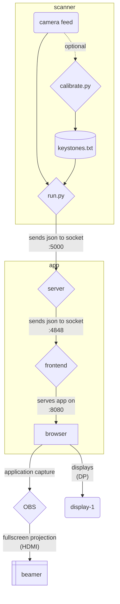

# windscope

this repository contains scripts and helpers for the windscope exhibit

## about windscope
A collaborative and interactive wind farm simulator. This project was done during the summer semester 2023 at ifgi.
This project is based on the existing future mobility project from Imaginary and adapted it towards the aim of this project.
Read more about it on the [windpark-simulator repository](https://github.com/ifgi/windpark-simulator)

## relevant repos
- [scanner](https://github.com/ifgi/windscope_scanner)
  - forked from [CityScoPy](https://github.com/CityScope/CS_CityScoPy)
- [app](https://github.com/ifgi/windpark-simulator)

## architecture
relies on [mise-en-place](https://mise.jdx.dev/) for easier dev setup and deployment


## setup the project from a clean system
> [!CAUTION]
> TBD
```sh
git clone --recurse-submodules https://github.com/dokxid/windscope.git
cd windscope
./create-user.sh  # needed if u want a kiosk user
./setup.sh
```

## start the server
> [!TIP]
> i would suggest using 3 separate terminal windows/tabs for every mise task
```sh
mise run
# a shell alias is defined for `run` to be aliased to `mise run`, so you can also run:
run
```
and now select the task you want
```system
 $ run
Tasks
Select a task to run
❯ calibrate  calibrate the scanner camera
  frontend   serve the simulator frontend
  scanner    start the scanner
  simulator  start the simulator API
↑/↓/k/j up/down • / filter • enter confirm
```
